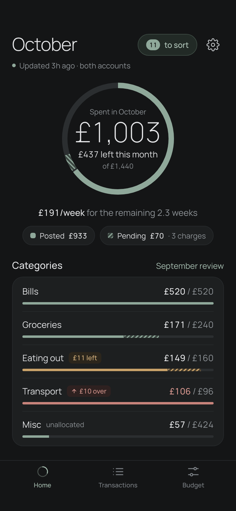
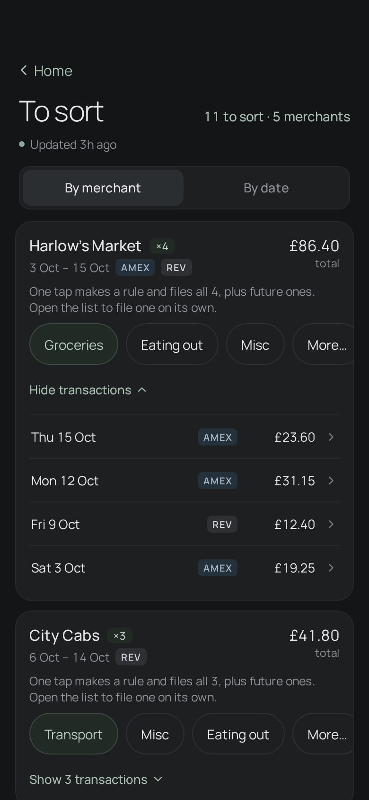
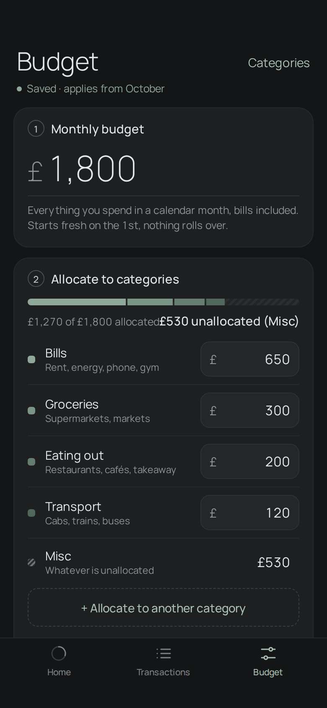

# Tally

A mobile-first budgeting app that brings all my bank accounts together in one place.

## Why I built it

Each of my banks has its own budgeting app, and each one sees only its own money. Nothing brought every account together to track spending against one budget. The few apps that do either have a clunky UI or put the useful features behind a subscription. So I built my own.

Tally pulls transactions from a Revolut account and a British Airways Amex card through [Lunch Flow](https://www.lunchflow.app), sorts them into categories with merchant rules, and answers three questions: how much is left this month, am I within each category, and where did the money go. It's quick enough for a daily glance and clean enough to keep using. Hosting runs on Cloudflare's free tier, so the only running cost is the Lunch Flow subscription that connects the banks.

The stack is one Cloudflare Worker (a React SPA plus a Hono API) with D1, behind Cloudflare Access.

**Status:** in daily use. Phase 1 (importer, auth, scheduled imports) and the first cut of Phase 2 (categories, rules, budgets, month summary) are done. Bills, insights and a weekly digest come next.

<p align="center">
  
  
  
</p>

<p align="center"><sub>Design mocks. Every name and figure is invented.</sub></p>

## What it does

- **Imports on a schedule.** A cron trigger pulls both accounts every 3 hours, and an import can also be run by hand. Re-imports are idempotent, and a pending charge counts until its posted version arrives.
- **Budgets by month.** You set one monthly figure and allocate parts of it to categories; whatever is left over is Misc. Home shows what's left, a per-week pace and a bar for each category, with posted and pending spend shown separately.
- **Sorts with rules.** A merchant rule sets a default category, and a per-transaction override always wins. Unmatched spending lands in **To sort**, where one tap files a whole merchant and creates its rule. Changing a rule re-sorts past transactions too.
- **Keeps history intact.** Bank data is never edited or deleted. Your edits live in a separate table, so they survive every re-sync.

## How it's built

| Layer | Choice |
|---|---|
| Frontend | React 19, Vite, Tailwind 4, TanStack Query |
| API | Hono on Cloudflare Workers, served from the same Worker as the static assets |
| Data | Cloudflare D1 (SQLite) with Drizzle migrations |
| Auth | Cloudflare Access at the edge, and the Worker checks the Access JWT itself |
| Tests | Vitest in the Workers runtime, with synthetic fixtures only |

A few details that took some care:

- **Money is integer minor units**, and dates are plain `YYYY-MM-DD` strings, so there's no float rounding and no UTC drift. Months and "today" are worked out in `Europe/London`.
- **The Worker verifies `Cf-Access-Jwt-Assertion` itself** (signature, `aud`, email), because Workers with static assets don't receive `ctx.access`. If Access is ever misconfigured, the API still refuses anyone but the owner.
- **It fits the D1 free tier.** Bulk upserts send each chunk as one `json_each` statement to stay under 50 statements per invocation. Every screen has a rows-read budget enforced in tests ([why](docs/research/d1-rows-read.md)).
- **Category matches are stored, not recomputed.** SQLite triggers keep track of which rule each merchant matches, so a read costs what it shows rather than a scan of the whole history ([plan](docs/stored-matches-plan.md)).

## Running it

You'll need Node 24+, a Cloudflare account with Zero Trust (the free plan is enough) and a Lunch Flow API key.

```sh
npm install
npm run db:migrate:local
npm run dev          # Vite + the Worker runtime, using a local D1
npm run check        # typecheck, lint and tests
```

Local values go in `.dev.vars`, which is gitignored: `LUNCHFLOW_API_KEY`, `ACCESS_TEAM_DOMAIN`, `ACCESS_AUD` and `ALLOWED_EMAIL`. In production, set the same four as Worker secrets with `wrangler secret put`; `wrangler deploy` refuses to deploy while any of them is missing. To deploy your own copy, change the D1 `database_id` in `wrangler.jsonc` and follow [docs/setup-responsibilities.md](docs/setup-responsibilities.md).

## Docs

Tally was planned in phases, and the docs are the record of those decisions.

| Doc | Contents |
|---|---|
| [architecture.md](docs/architecture.md) | Architecture, environments and default decisions |
| [phase-1-plan.md](docs/phase-1-plan.md) | Phase 1 steps (importer, auth, cron), each with acceptance checks |
| [phase1-assessment.md](docs/phase1-assessment.md) | How fresh the data is, how pending charges behave, what Phase 2 had to allow for |
| [phase-2-outline.md](docs/phase-2-outline.md) | The looser Phase 2 outline the spec grew from |
| [phase-2-spec.md](docs/phase-2-spec.md) | Budgeting: categories, rules, overrides, budgets, month summary |
| [phase-2-insights-spec.md](docs/phase-2-insights-spec.md) | Insights, analytics, stale-data warnings and the weekly email digest |
| [insights-ui-brief.md](docs/insights-ui-brief.md) | What the Insights tab, review, trends, merchant and digest screens show, for design |
| [schema-and-api.md](docs/schema-and-api.md) | D1 schema and API endpoints |
| [ui-design.md](docs/ui-design.md) | Mobile UI spec: theme tokens, navigation, every screen and state |
| [research/platform-constraints.md](docs/research/platform-constraints.md) | Verified Lunch Flow and Cloudflare free-tier facts, with sources |
| [lunchflow-findings.md](docs/lunchflow-findings.md) | Observed Lunch Flow API behaviour |
| [estimates-and-risks.md](docs/estimates-and-risks.md) | Original time estimate and the main risks |
| [setup-responsibilities.md](docs/setup-responsibilities.md) | One-time setup, and which steps the owner does by hand |

## Privacy

This repo holds code and docs only. Real transactions never go into commits, fixtures or logs, and logs record only counts, statuses and durations. Credentials live in Worker secrets and a gitignored `.dev.vars`, and CI runs gitleaks over the full history.
